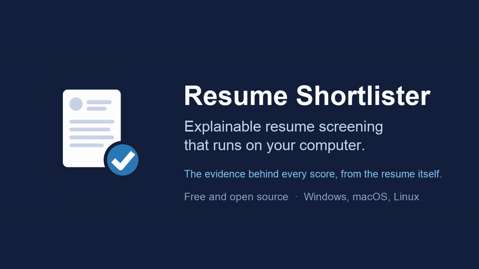

# Resume Shortlister

[](LICENSE)
[](#get-started)
[](#limitations)

**Explainable resume screening that runs on your computer. It ranks and
explains; the recruiter decides.**

[Install](#get-started) · [What it offers](#what-it-offers) · [How it is different](#how-it-is-different) ·
[Try it with sample resumes](#try-it-with-sample-resumes) · [Your data](#your-data-stays-on-your-computer)

Give it the resumes for a job, either a folder or files you drop on the page,
and the job description. It screens every resume, recommends whom to interview,
and shows the evidence behind every score: the line in the resume that proves
each requirement. Then ask about the candidates, compare them or change the
role, and the shortlist updates.



## What it offers

- **A shortlist you can check.** Every candidate's score comes with its
  breakdown, a verdict per requirement quoted from their resume, strengths,
  gaps and risk flags, and the rule behind the recommendation.
- **A folder or uploaded files, screened the same way.** Point it at the folder
  where your applicants' resumes are, or drop any number of resume files on the
  page: uploads are indexed exactly like a folder and go through the same three
  rounds. New files are added as they come; unchanged ones are not read again.
- **Requirements you confirm.** It reads must-haves, nice-to-haves, years and
  degrees from the job description, and asks you about anything the text
  leaves open before it screens.
- **A conversation about the shortlist.** "Why is Priya above Wei?", "Compare
  the top 3", "Make Azure a must-have", "Write interview questions for the top
  candidate".
- **Reports to share**: the shortlist and each candidate's report, as files.

## How it is different

**From keyword filters** (the screening built into most applicant tracking
systems): those pass or reject on exact words and say nothing about why.
Resume Shortlister combines meaning, keywords and must-have checks, knows the
common other spellings of skills ("vSphere" for VMware, "k8s" for Kubernetes),
and explains every result with the resume's own words.

**From AI screening services**, where resumes are uploaded to a vendor and a
model gives a score:

- **Your resumes stay with you.** It runs on your computer: no account, no
  server of ours. Only the AI model you choose reads resume text, without names
  or contact details; with a local model (Ollama), nothing leaves your computer.
- **The model reads, code decides.** The AI model only reads resumes and quotes
  evidence. Scores, knockouts and recommendations come from fixed rules you can
  audit, and a verdict whose quote is not in the resume is downgraded.
- **Blind screening.** The model never sees a candidate's name, contact details
  or personal fields.
- **The same input gives the same result**, and two different AI models
  recommended the same candidates in our
  [measurements](docs/how-it-works.md#guardrails).
- **Free and open source** (MIT), with any AI provider: OpenAI, Anthropic,
  Google Gemini or Ollama on your own computer.

## Get started

Runs on **Windows 10 and 11, macOS and Linux**. You need an API key from an AI
provider (OpenAI, Anthropic or Google Gemini), or [Ollama](https://ollama.com)
on your computer. Nothing else: no Python, no git.

An API key is not part of a ChatGPT or Claude subscription: you make it on the
provider's developer site ([OpenAI](https://platform.openai.com/api-keys),
[Anthropic](https://console.anthropic.com/settings/keys),
[Google](https://aistudio.google.com/apikey)), which bills its use separately.
Screening sends resume text, without names or contact details, to that provider:
check your organisation's policy on candidate data first, or use Ollama, with
which nothing leaves your computer.

### Install

**Windows:** open PowerShell (Start menu, type "PowerShell"), paste this line
and press Enter:

```powershell
powershell -ExecutionPolicy ByPass -c "irm https://raw.githubusercontent.com/Akshay-Jhijhautia/resume-shortlister/main/install.ps1 | iex"
```

**macOS or Linux:** open a terminal (on macOS: Applications › Utilities ›
Terminal), paste this line and press Enter:

```bash
curl -LsSf https://raw.githubusercontent.com/Akshay-Jhijhautia/resume-shortlister/main/install.sh | sh
```

(On Linux without curl: `wget -qO- https://raw.githubusercontent.com/Akshay-Jhijhautia/resume-shortlister/main/install.sh | sh`.)

It takes a minute or two and needs no administrator rights. It asks for your
OpenAI key (press Enter to skip; the app asks too, and lets you choose another
provider), puts **Resume Shortlister** in Applications (macOS), the Start menu
and on the desktop (Windows) or the app menu (Linux), and starts it.
What it does: [install.ps1](install.ps1), [install.sh](install.sh).

### Use it

1. **Open Resume Shortlister** from its icon. It opens in your browser; the
   first time, choose your AI provider and paste its key (saved only on this
   computer).
2. **Give it the resumes**: drop the files on the page, or paste the path of
   the folder they are in and click Load. The first time it downloads its
   language model (about 200 MB) and reads every resume, showing how far it is.
3. **Paste the job description** and click Screen resumes (about a minute).
4. **Open a candidate** for the evidence behind their place, and prepare their
   interview questions. Ask follow-ups in the conversation below the shortlist.

**Quit** (top right) stops the app; Sessions reopens any earlier screening.

### Try it with sample resumes

Download [resume-shortlister-sample-resumes.zip](https://github.com/Akshay-Jhijhautia/resume-shortlister/releases/latest/download/resume-shortlister-sample-resumes.zip):
100 fictional resumes and three job descriptions (the people and companies do not
exist). Unzip it, load the `resumes` folder, and paste a job description from
`job-descriptions`. Its `README.txt` walks you through it.

### For the best results

- **Paste the whole job description**, with its "Requirements" and "Nice to
  have" sections: what the requirements name becomes a must-have.
- **Answer its questions** about requirements the description leaves open,
  and adjust in the conversation ("make SQL Server a must-have").
- **One folder per job opening**, with text PDFs or DOCX files. Scanned PDFs
  and images are not read (they are listed so you can convert them).
- **Check the near misses**: the downloaded report lists the closest
  candidates who missed a must-have, in case a resume words a skill unusually.
- **Treat the shortlist as a starting point.** Review the recommendations,
  especially those near the threshold; people make the hiring decisions.

### Update or remove it

- **Update:** when a newer version is out, the app says so. Run the install
  line again; your key, settings and screenings are kept.
- **Remove:** run the uninstall line. It removes the app and its icon, and asks
  before deleting your data.

  ```powershell
  powershell -ExecutionPolicy ByPass -c "irm https://raw.githubusercontent.com/Akshay-Jhijhautia/resume-shortlister/main/uninstall.ps1 | iex"
  ```

  ```bash
  curl -LsSf https://raw.githubusercontent.com/Akshay-Jhijhautia/resume-shortlister/main/uninstall.sh | sh
  ```

| If | Then |
| --- | --- |
| The model says the key is wrong | Settings (the model name, top right) › **Change AI provider or key** |
| Windows: "running scripts is disabled" | Paste the whole install line, which allows this one script; if your organisation blocks it, ask your IT team |
| Anything else | The app's log is `~/.resume-shortlister/app.log`; [open an issue](https://github.com/Akshay-Jhijhautia/resume-shortlister/issues) with it |

Developers can also install with pip (`pip install "resume-shortlister[anthropic,google,ollama]"`,
Python 3.11+) and use it in the terminal (`resume-shortlister chat`, `screen`): see
[Usage](docs/usage.md) and [Development](docs/development.md).

## Your data stays on your computer

Everything the app keeps is in one folder, `~/.resume-shortlister` (on Windows,
`C:\Users\<you>\.resume-shortlister`): the index of each resume folder, copies of
uploaded files, saved screenings, reports and your settings. Resume text goes
only to the AI model you choose, without names or contact details when it judges
candidates. The app's only other request is to PyPI, where it is published, once a
day for the newest version number; it sends nothing about you or your resumes
(`RESUME_SHORTLISTER_UPDATE_CHECK=false` turns it off).

To clear the candidate data and start from scratch, keeping your key:
`resume-shortlister clean --all --yes` ([more](docs/usage.md#local-data)).

## How it works

1. **Initial screen.** Every resume gets a search score (meaning, keywords and
   must-have coverage) and the must-have checks; the best 10 that pass go on.
   No AI calls.
2. **Deep review.** The AI model reads each shortlisted resume and gives a
   verdict per requirement, with a quote from the resume. Code checks the
   quotes and computes the score.
3. **Recommendation.** A fixed rule recommends an interview or not; the model
   only writes the rationale. Borderline candidates get what would make them a
   clear interview.

Details and measurements: [How it works](docs/how-it-works.md).

## Responsible use

It assists people who screen resumes; it does not make hiring decisions, and it
should not reject anyone without a person reviewing the result.

- **Bias.** Screening is blind to names, contact details and personal fields
  ([details](docs/how-it-works.md#blind-screening)), and employment gaps are
  listed for you to ask about, never scored. Other signals remain (schools,
  graduation years, locations), so check it on your own data before relying on it.
- **Regulation.** Software that assists hiring is regulated in some places: the
  EU AI Act treats it as high-risk, and New York City requires bias audits of
  automated screening tools. Check what applies to you; this project gives no
  compliance guarantees.
- **Candidates can game resumes.** Instruction-like text is flagged, but treat
  any result as the start of a conversation, not a verdict.

## Limitations

- **Tested, not yet proven in hiring.** Ranking quality was measured on
  synthetic resumes, and the tool was run on 684 real, anonymised resumes
  (public examples); it has not yet been validated on a real hiring pipeline.
- **Only OpenAI's models have been compared** for stability; Anthropic, Gemini
  and Ollama work but have not been measured.
- **A skill written an unusual way can be missed** ("Windows 2000, 2003 Server"
  is not read as Windows Server): look at the near misses in the report.
- **Skill years** come from the dated roles that mention a skill; one listed
  only in a Skills section counts as unverified.
- **Not read:** `.doc`, `.rtf`, `.odt`, scanned PDFs, images, and subfolders of
  a resume folder.

## Documentation

| Guide | What it covers |
| --- | --- |
| [Usage](docs/usage.md) | The browser app, the terminal chat and every command, your resumes, local data, Docker |
| [Configuration](docs/configuration.md) | AI providers, embeddings, every setting |
| [How it works](docs/how-it-works.md) | The three rounds, requirements, guardrails, reproducibility, design decisions |
| [Development](docs/development.md) | Working on the code: setup, layout, tests and measurements |
| [Changelog](CHANGELOG.md) | Changes per version |

## License and security

MIT, see [LICENSE](LICENSE). Report vulnerabilities privately as described in
[SECURITY.md](SECURITY.md).
